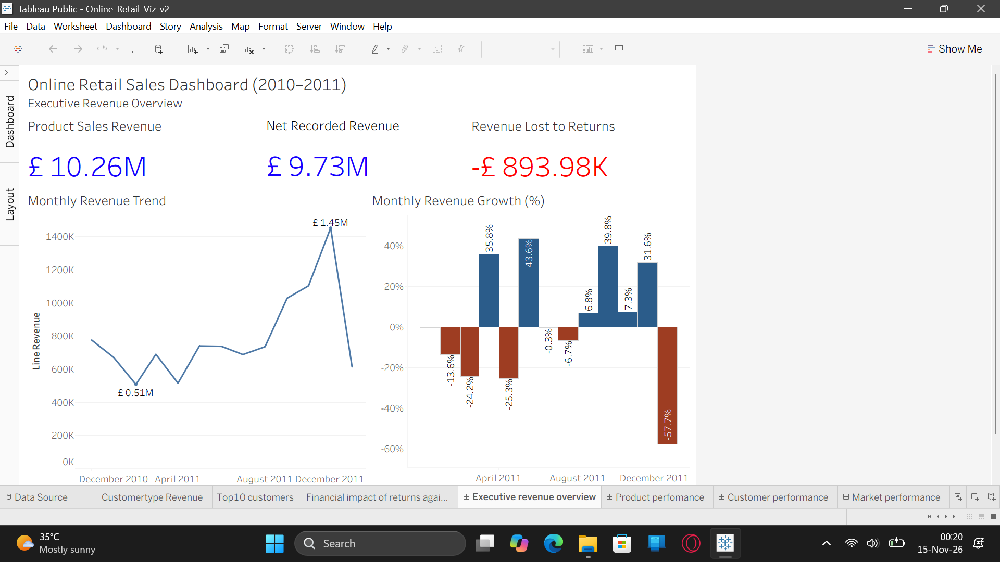
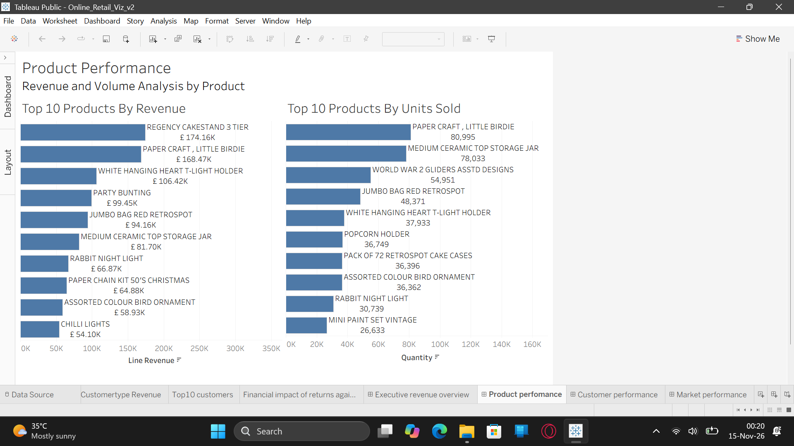
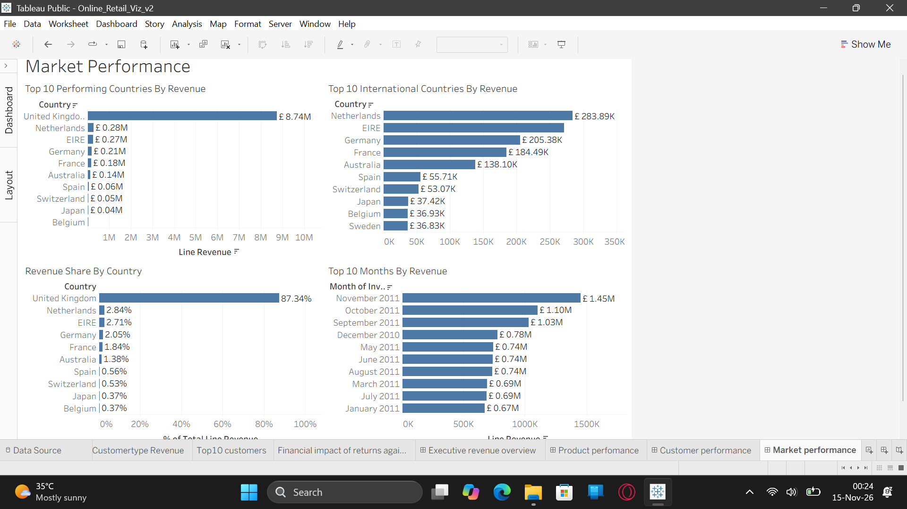
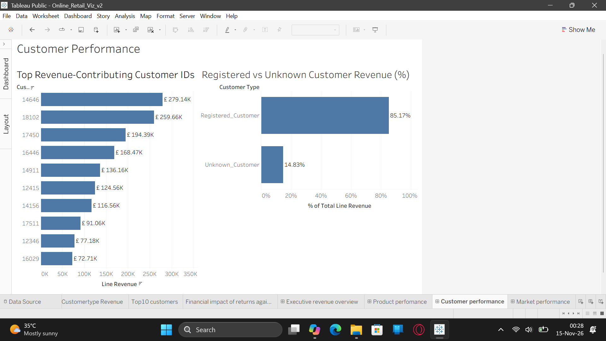

## Project Overview

This project analyzes the UCI Online Retail dataset using MySQL and Tableau.

The objective of this project was to transform raw transactional retail data into actionable business insights through:

- Data Cleaning
- Data Quality Assessment
- Exploratory Data Analysis (EDA)
- Interactive Dashboard Development

**Tools Used**

- MySQL
- Tableau Public
- GitHub

**Dataset**

- UCI Machine Learning Repository – Online Retail Dataset

---

## Project Structure

├── SQL

│   ├── 01_Data_Cleaning.sql

│   └── 02_EDA.sql

│

├── Dashboard_Images

│   ├── Executive_Revenue_Overview.png

│   ├── Product_Performance.png

│   ├── Customer_Performance.png

│   └── Market_Performance.png

│

└── Tableau

    └── Online_Retail_Dashboard.twbx

---

## Data Cleaning Summary

The raw dataset contained **541,909 records**.

Key cleaning activities included:

- Removed 5,268 exact duplicate records
- Standardized text formatting and whitespace
- Standardized 2,857 product description records using a manually validated StockCode mapping table
- Converted blank values to NULL
- Investigated negative quantities and returns
- Investigated zero and negative pricing records
- Created transaction quality flags
- Created product revenue calculations
- Preserved legitimate business adjustments and return transactions
  
Key Data Quality Findings
135,037 records contained missing Customer IDs.
2,512 records contained zero or negative Unit Prices.
10,587 records contained negative Quantities.
Operational StockCodes (e.g., POST, M, D, BANK CHARGES) were retained and analyzed separately.
Missing descriptions were preserved rather than imputed to avoid introducing incorrect values.

**Rows Before Cleaning:** 541,909

**Rows After Cleaning:** 536,641

---

## Exploratory Data Analysis

The following business questions were explored:

1. How did revenue perform over time?
2. Which products generated the most revenue?
3. Which products sold the highest volume?
4. Which customers generated the most revenue?
5. Which countries generated the most revenue?
6. What was the financial impact of returns?

---

## Key Findings

### Revenue Performance

- Product Sales Revenue: £10.26M
- Net Recorded Revenue: £9.73M
- Revenue Lost To Returns: £893.98K

### Product Performance

- Regency Cakestand 3 Tier generated the highest revenue.
- Paper Craft, Little Birdie recorded the highest sales volume.

### Customer Performance

- Registered customers generated approximately 85% of total revenue.
- The top 10 customers contributed a significant portion of revenue.

### Market Performance

- The United Kingdom generated approximately 87% of total revenue.
- The Netherlands was the highest-performing international market.

---

## Dashboards

Dashboard 1: Executive Revenue Overview

Key Insights
- Product Sales Revenue: £10.26M
- Net Recorded Revenue: £9.73M
- Revenue Lost to Returns: £893.98K

This dashboard provides an executive-level overview of revenue performance, monthly revenue trends, return impact, and revenue growth between 2010 and 2011.

Dashboard 2: Product Performance

Key Insights
- Regency Cakestand 3 Tier generated the highest revenue.
- Paper Craft, Little Birdie recorded the highest sales volume.

This dashboard compares top-performing products by revenue and sales volume.

Dashboard 3: Customer Performance

Key Insights
- Registered customers generated approximately 85% of total revenue.
- The top 10 customers contributed a significant share of revenue.

This dashboard explores customer revenue contribution and customer segmentation.

Dashboard 4: Market Performance

Key Insights
- The United Kingdom contributed approximately 87% of total revenue.
- The Netherlands was the highest-performing international market.

This dashboard highlights market concentration and international revenue performance.

---

## Skills Demonstrated

- SQL Data Cleaning
- SQL Window Functions
- Data Validation
- Data Quality Management
- Exploratory Data Analysis
- Business Intelligence Reporting
- Tableau Dashboard Development
- Data Storytelling

